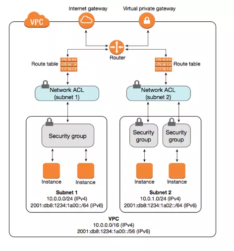

## Overview

In this project, I self-host a Github Action Runner on AWS EC2, by then running my data crawler into this runner

- **Bank Crawker**: Single loading bank's logos and saving them into `.\data\img`
- **Weather Station data**: Schedule loading daily to obtain weather data of worldwide stations and saving as .csv into `./data/weather/station_data_{current_date}.csv`

## Ebstablish Networking Infrastructure on AWS

Initially, to host a EC2, I need to build up Networking on Amazon Web Services. 

Following strictly security assurance, the Networking *MUST* embrace these features:

- Create 2 subnets in VPC: **PRIVATE** and **PUBLIC** subnet
- Own at least 1 Elastic IP and attach an address to **NAT Gateway**
- Place **NAT Gateway** within **PUBLIC** subnet
- Define **AWS Route Table** that routes all traffics from Internet to **NAT Gateway**
- EC2 Instances would be placed in **PRIVATE** subnet. Every execution requests from Github Actions would go through **NAT Gateway** before landing inside instance

This regulation protects EC2 instances from Internet's attacks effectively because there's no any Public IP assigned to instances. **NAT Gateway** owns simutaneously 2 IPs: 1 Private IP and 1 Public IP, while EC2 only has Private one.
**NAT Gateway** roles as a translator to convert Private IPs, which are derived by a private instance reaching out Internet, into shared **Elastic IP**. Various Private instances only require one shared **Elastic IP** to connect Internet.
This method is especially beneficial when users do not want to explicitly define either **Security Group** or **Network ACLs** for a single traffic.

## Self-Hosting Runner using Terraform and Github Action

First of all, I seperate 2 environment `prod` and `nonprod`, the next step is about to define these **Secrets** for each environments:

- `AWS_ACCESS_KEY_ID`
- `AWS_SECRET_ACCESS_KEY`
- `AwS_SESSION_TOKEN`
- `AWS_DEFAUTL_REGION` (us-east-1)
- `GHA_RUNNER`: The shell script to allocate execution's trigger to EC2
 
The workflow `aws_infra_deployment.sql` build entire AWS infrastucture and runner. In each runs, Terraform automatically compare the current state of objects to the previous state in `.tfstate` file (I put it in `s3://${{ github.event.repository.name }}-${{ inputs.environment }}`) to detect changes and apply them into relevant objects.

## Bank Crawler

The workflow `aws_s3_uploading` is about to crawl the logos of banks using [VietQR API](https://api.vietqr.io/v2/banks) and save into folder `.\img`

Eventually, uploading entire target folder to AWS S3 bucket`

Required workflow's parameters:

- `enviroment`: default `nonprod`, the target AWS Account

## Worldwide Weather Station Crawler

This crawler call request, which is originated from [IOWA API documentation](https://mesonet.agron.iastate.edu/api/)

For each `GET` request, the result is extremely large. Due to the size of data, the common I/O cannot afford. The solution is creating IO stream session and loading data chunk by chunk to avoid OOM error

The pipeline `Weather Crawler` is scheduled daily at 00:00 AM to ingest data as `.csv` into folder `.\data\weather\station_weather_{current_date}.csv`, by then pushing changes to `main` branch

Required workflow's parameters:

- `target_folder`: default `.\data\weather`, the target folder path of successful data
- `limit data`: default 10, the number of stations per execution, if the `limit data = 0`, do crawling over entire station id 

